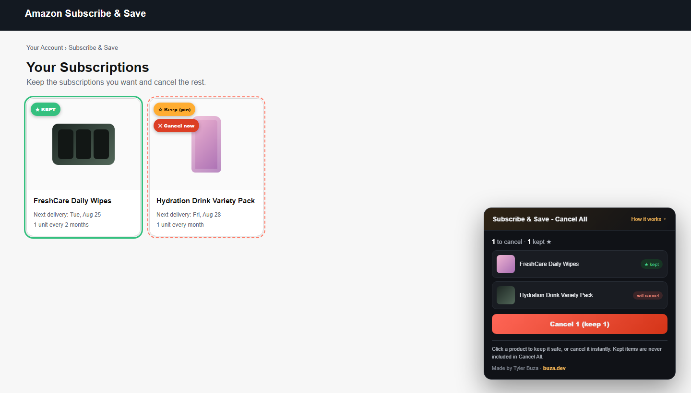
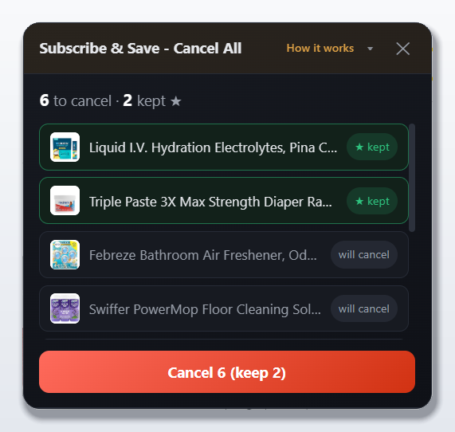
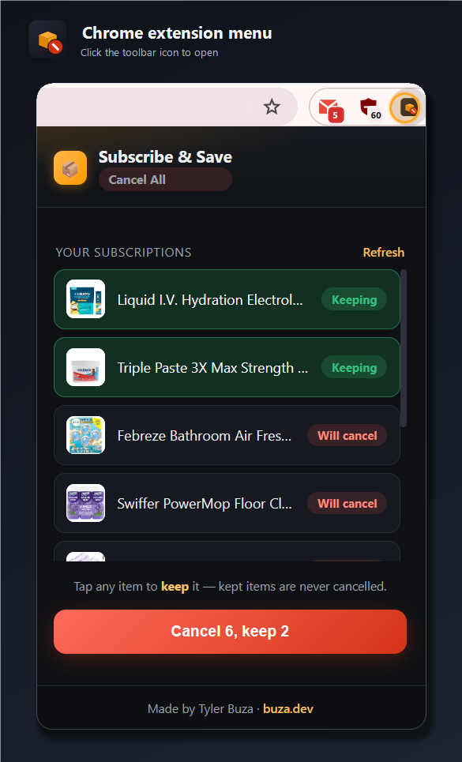

# Amazon Subscribe & Save: Cancel All & Reminders

Keep the subscriptions you still use and cancel the rest together, right on Amazon. Get a reminder while you browse when a delivery is coming up.

Works on **Amazon.com**, **Amazon.ca**, and **Amazon.co.uk**. Using Firefox? [See installation options](#how-to-install).

## Choose what to keep

1. **Open Subscribe & Save** on the Amazon site where you shop and sign in.
2. **Select Keep** on each item you want to receive. Kept items are starred, and the extension remembers your choices the next time you visit.
3. **Check the count before cancelling.** A button labeled **Cancel 6 (keep 2)** requests cancellation for six subscriptions and leaves the two starred ones alone. To cancel just one, use **Cancel now** on its product card.

Cancelling a subscription stops future deliveries once Amazon confirms it. If an order has already been created, check **Your Orders** on Amazon separately.

### Two places to manage your list

Open the floating panel on your Amazon subscriptions page, or click the extension icon in your browser toolbar. Both show which items you’re keeping before you act.

  
  &nbsp;
  

### Upcoming delivery reminders

The extension saves delivery estimates from your subscriptions page and can pick up new subscriptions on Amazon’s confirmation page. When a saved delivery is within seven days, a reminder appears **while you’re browsing Amazon**. Choose **Keep shipment**, cancel the subscription, or close the reminder for 24 hours. The date is Amazon’s delivery estimate, not a cancellation deadline.

## How to install

**Chrome:** Open the [Chrome Web Store listing][chrome-store] and select **Add to Chrome**. To keep the menu handy, open the puzzle-piece menu in your toolbar and pin the extension.

<strong>Firefox — temporary installation</strong>

1. Open [Downloads][downloads], download the ZIP with **firefox** in its name, and unzip it.
2. Enter `about:debugging#/runtime/this-firefox` in the address bar.
3. Select **Load Temporary Add-on…** and choose `manifest.json` from the unzipped folder.

Firefox removes temporary add-ons when it restarts. Repeat steps 2–3 to load it again.

<strong>Chrome, Edge, Brave, or Opera — manual installation</strong>

1. Open [Downloads][downloads], download the ZIP with **chromium** in its name, and unzip it.
2. Open your browser’s extensions page (`chrome://extensions`, `edge://extensions`, `brave://extensions`, or `opera://extensions`).
3. Turn on **Developer mode**, select **Load unpacked**, and choose the unzipped folder containing `manifest.json`.

## Privacy & support

Your subscription list, Keep choices, and reminder preferences are stored in your browser. The extension uses your existing Amazon session to read subscriptions and send cancellation requests directly to Amazon. No developer servers, ads, or analytics.

[Privacy policy](PRIVACY.md) · [Report a problem][issues] · [Downloads][downloads]

Made by [Tyler Buza](https://buza.dev). Independent project; not affiliated with or endorsed by Amazon.

[chrome-store]: https://chromewebstore.google.com/detail/amazon-subscribe-save-can/lfolfbnoncelnmacofhfjlldpfbdodji
[downloads]: https://github.com/TylerBuza/amazon-subscribe-save-cancel-all/releases/latest
[issues]: https://github.com/TylerBuza/amazon-subscribe-save-cancel-all/issues
